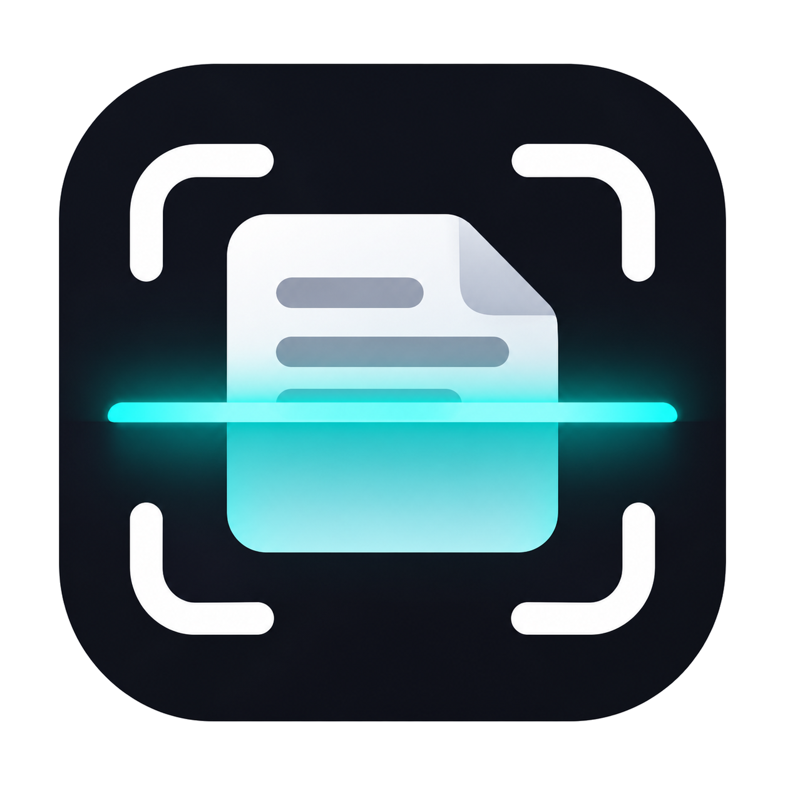

<div align="center">



# Nuvora

**Escanea documentos con tu teléfono. Sin cuentas, sin nube, sin Internet.**

Una alternativa **libre y de código abierto** a CamScanner.


### [⬇️ Descargar la última versión](../../releases/latest)

</div>

<!--
  Capturas de pantalla: agrégalas en docs/capturas/ y descomenta este bloque.
  <p align="center">
    
    
    
  </p>
-->

---

Nuvora convierte una foto tomada a pulso en un documento limpio, recto y listo para compartir en PDF. Todo el procesamiento ocurre **en tu teléfono**: tus documentos nunca salen de él.

Si buscas lo esencial de CamScanner sin anuncios, sin suscripciones, sin marcas de agua y sin subir tus documentos a ningún servidor, Nuvora es para ti. Y como es código abierto, cualquiera puede revisar qué hace con tus archivos.

## ✨ Qué hace

📐 **Encuentra la hoja por ti.** Mientras apuntas con la cámara, Nuvora marca el contorno del documento en vivo. Al tomar la foto ya trae las esquinas detectadas, incluso con fondos con mucho ruido o si la hoja se sale un poco del cuadro.

🔲 **Endereza la perspectiva.** No importa si fotografiaste la hoja en ángulo: queda plana y rectangular, como salida de un escáner.

📄 **Tamaño Carta u Oficio, automático.** Nuvora calcula la proporción real de la hoja y la ajusta al tamaño de papel que corresponde. También puedes elegir Carta, Oficio, A4 o dejarla como está.

✨ **Aspecto de escaneo.** El filtro *Mejorado* borra sombras, deja el papel blanco y el texto negro y nítido, y conserva el color de firmas y sellos. También hay *B/N*, *Grises* y *Original*.

👀 **Ves el resultado antes de guardarlo.** Cada foto pasa por una revisión: ajustas los bordes, eliges tamaño y filtro, la giras y la agregas al documento. Luego sigues con la siguiente página.

📚 **Tu biblioteca, ordenada.** Documentos de varias páginas, carpetas, búsqueda por título y páginas que se reordenan arrastrando. Cada página se puede volver a editar sin perder calidad.

📤 **PDF en un toque.** Exporta a PDF con el tamaño de papel real de cada página y compártelo por WhatsApp, correo o la app que quieras. También puedes compartir las imágenes.

🖼️ **También desde la galería.** Importa fotos que ya tenías y pásalas por la misma revisión.

## 🔒 Privacidad

- **Sin Internet:** la app ni siquiera pide ese permiso.
- **Sin cuentas** ni registro.
- **Tus documentos se guardan en el espacio privado de la app.** Solo salen de ahí si tú los compartes.

## 📲 Instalación

1. Descarga el archivo `.apk` de la [última versión](../../releases/latest).
2. Ábrelo en tu teléfono. Si Android lo pide, permite **"Instalar apps desconocidas"** para el navegador o la app de archivos que uses.
3. Si aparece un aviso de Play Protect, elige **"Instalar de todas formas"**. Ocurre porque la app no viene de Play Store.

| Requisito | |
|---|---|
| Android | 7.0 o superior |
| Teléfono | 64 bits (prácticamente todos desde 2017) |
| Espacio | ~35 MB, más ~1–3 MB por página |


## ⚠️ Antes de usarla

Nuvora está en sus primeras versiones:

- **No hay respaldo en la nube.** Desinstalar la app borra los documentos que guardaste, así que comparte o guarda en otro lado los PDF importantes.
- **Por ahora solo existe para Android** y en español.

La lista completa de limitaciones está en la [guía técnica](docs/DESARROLLO.md#lo-que-no-cubre-esta-versión-limitaciones-y-pendientes).

## 💚 Código abierto

Nuvora es software libre bajo la [licencia MIT](LICENSE): puedes usarlo, estudiarlo, modificarlo y compartirlo. Se agradecen los reportes de errores, las ideas y los *pull requests*.

## 🛠️ Para desarrolladores

Nuvora está hecha con **Flutter**, **OpenCV** (`opencv_dart`) y **SQLite** (`drift`).

```bash
flutter pub get
dart run build_runner build
flutter run
flutter test
```

La guía técnica, [docs/DESARROLLO.md](docs/DESARROLLO.md), cubre:
- La arquitectura.
- Cómo funcionan la detección de bordes, el ajuste de tamaño de papel y los filtros.
- Cómo compilar y regenerar el ícono.
- Las limitaciones conocidas.

---

<sub>Nuvora es un proyecto independiente y no está afiliado, patrocinado ni respaldado por CamScanner ni por INTSIG Information Co., Ltd. CamScanner es una marca de sus respectivos propietarios; se menciona solo como referencia.</sub>
